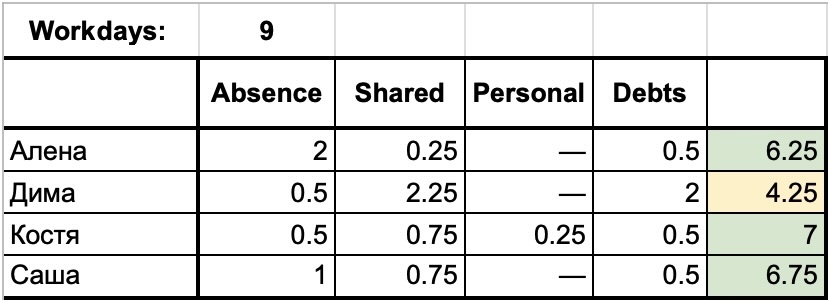

# Заметки техлида. 15 лет геймдева

Техлиду нужны компетенции в технологиях, организации процессов, работе с людьми и понимание интересов бизнеса. При этом требования в этих зонах ответственности зачастую противоречат друг другу. В статье попробовал собрать наиболее интересные наблюдения из своего опыта, которые помогают мне находить баланс при принятии решений.

Я уже 15 лет работаю в геймдеве. По специальности — программист. Первую половину 2010-х портировал сингловые казуалки с Windows на iOS. Большую часть этих лет работал в мобильном департаменте компании "Леста". Последние 10 лет занимался клиент-серверными midcore-проектами с полноценным мета-геймплеем и PvP. Последние 5 из них занимал позицию техлида.

За эти пять лет у меня было три проекта и три команды, а какое-то время я отвечал за две команды одновременно. Кроме того, мы создали общую платформу для продакшена: унифицировали клиент-серверные решения, подходы к разработке и процессы. Благодаря этому разработчики могли относительно легко переключаться на задачи соседней команды. Был и опыт найма: около сотни проведенных собеседований и более 20 нанятых сотрудников.

Вот, пожалуй, и основные вводные: специализация, домен, масштаб и стаж. Это чтобы была понятна область применимости моих выводов.

Статья может быть интересна не только начинающим техлидам и тем, кто хочет сравнить свой опыт с моим, но и тем, кто по другую сторону баррикад, — чтобы лучше понимать логику решений своих руководителей. Заодно попробую новый для себя формат — сборник небольших заметок о разных сторонах профессии. В каждой из них главный **инсайт** буду выделять жирным.

Я старался, чтобы статья не превратилась в очередную компиляцию best practices для менеджеров. Здесь только то, что становилось для меня личным открытием.

## Самоорганизация

Первое, что меняется при переходе из старших разработчиков в лиды, — это фокус внимания. Разработчик даже высокого грейда с собственной зоной ответственности по большей части смотрит вглубь: отвечает за фичу или часть стека. Лид смотрит вширь и отвечает сразу за несколько областей, которым нужны разные компетенции и даже способности:

- технологии,
- процессы,
- команда,
- бизнес.

Кроме того, лид становится интерфейсом своей части команды, формальной точкой ответственности за технические процессы и коммуникации. Такое радикальное **расширение ответственности требует хороших навыков самоорганизации**: обработка входящих, декомпозиция и приоритизация проблем и задач, учет и визуализация обязательств. Какая именно это будет система — не так важно, но без нее остается только реактивный режим.

А еще полезно фиксировать договоренности, решения и важные наблюдения о процессах и команде. На ревью и ретроспективах такие записи помогают опираться на факты.

При этом большую часть вышеперечисленной информации неуместно хранить в общем таск-трекере или вики, для нее нужна персональная система хранения.

Подробнее я обсуждаю эти вопросы в статьях:

- ["Самоорганизация: от потребностей к календарю"](../../articles/selforg/2026-03-25%20Selforg.md),
- ["Самоорганизация: от календаря к выполнению"](../../articles/selforg-res/2026-06-14%20Selforg%20resources.md),
- ["Дневник, заметки, рабочий лог — как они у меня оказались в одной папке"](../../articles/notes/2026-04-17%20Notes.md).

## Все еще программист или уже менеджер?

Распространено мнение, что программист, выросший до руководителя, становится преимущественно менеджером. Я с этим не согласен. Техлид — это все еще по большей части операционный уровень, зачастую всего на одну ступень выше линейного специалиста. Работы непосредственно с кодом действительно становится меньше, но **технические скилы остаются базой**. Лид отвечает за всю техническую часть проекта, а это значит, что если разработчик заболел или не справился с задачей, все последствия разгребать ему.

## Авторитет

Назначение на должность техлида дает формальные полномочия, к которым авторитет автоматически не прилагается. Особенно остро этот вопрос стоит в среде программистов — людей умных, самостоятельных и нередко своевольных. Я думаю, в общем случае **авторитет складывается из силы и справедливости**.

Сила — это техническая компетентность. Нужно хорошо понимать устройство проекта, видеть последствия решений и уметь аргументировать свою позицию. При этом знать все не обязательно: отдельные разработчики вполне могут разбираться в своих областях лучше лида. И тут нужна справедливость — готовность признавать чужую правоту и давать другим возможность влиять на решение.

Но окончательное решение все равно остается за лидом: он учитывает интересы проекта в целом и взвешивает варианты. И когда даже те, кто отстаивал другую позицию, соглашаются с его аргументами, формальные полномочия становятся авторитетом.

## Задача архитектуры

В геймдеве архитектура традиционно менее формализована, чем в других сферах разработки. Современные игровые движки хоть и дают готовые решения и инструменты для графики, звука, физики, сети, но не покрывают все уровни организации приложения.

Возьмем клиентскую часть. В играх с развитым мета-геймплеем много UI, разветвленные графы переходов по меню, экраны с поздравлениями и получением лута. Для реализации отдельных экранов есть MVC и подобные паттерны, разные реактивные подходы. А общепринятого способа представить игру как единый флоу сценариев, который ведет игрока от загрузки и авторизации через мета-геймплей ко входу в кор-сессию и обратно, нет. Добавьте еще сюда туторы, произвольно меняющие этот флоу... ну вы поняли, без костылей никак.

Реальная и когнитивная сложность системы — разные вещи. Первая определяется количеством элементов, их состояний и связей между ними и растет экспоненциально с добавлением нового функционала. Вторая — тем, сколько всего разработчику нужно удерживать в голове, чтобы с системой работать. Я бы сказал, что **задача архитектуры — уменьшать когнитивную сложность** системы относительно реальной. За счет декомпозиции и абстракций архитектура сдерживает рост когнитивной сложности, а вместе с этим и стоимости поддержки.

## Архитектура должна быть посильна

Сама архитектура тоже может стать источником когнитивной сложности, поэтому я старался **соотносить решения с возможностями команды**. Например, на каком-то этапе я намеренно удерживал стек узким, пока средний скил команды был между Upper Junior и Middle. Изоляция геймплейной логики от инфраструктурного кода и сервер на C# позволили Unity-разработчикам с небольшим опытом делать фичи мета-геймплея и на клиенте, и на сервере. Это дало возможность обойтись без традиционно выделенных бэкендеров.

## Стоит ли откладывать архитектуру?

Архитектуру обычно откладывают на поздние стадии. При поиске USP нужно быстро проверять гипотезы, а архитектурные ограничения мешают просто прокинуть костыль и двигаться дальше. На первых итерациях такой подход действительно экономит время. Но по мере накопления техдолга каждое следующее изменение обходится все дороже.

При этом даже MVP, который планируется выпустить в сторы, требует интеграций с аналитическими и маркетинговыми сервисами, механизма организации пользовательских сценариев, аналитики и диагностики. Все это придется делать в любом случае, поэтому я бы **с самого начала отделял относительно стабильную инфраструктуру** от сильно мутабельного геймплея.

А еще планка качества на мобильном рынке сейчас высокая: уже на этапе проверки гипотезы игроки ожидают продуманного до мелочей пользовательского опыта, который требует немалой реальной сложности проекта. Да и продукт делается с расчетом на успех — если гипотеза сработает, экономия на архитектуре приведет к необходимости все выбросить и начать заново.

## Чукча теперь читатель

Программисты не очень любят читать чужой код, потому что это сложно. Еще Роберт Мартин писал, что чтение кода на порядок дороже его написания, ведь приходится восстанавливать чужую логику решения. Для техлида эта проблема особенно актуальна: он отвечает за кодовую базу всей команды и постоянно разбирается в чужих реализациях.

Представьте, что у вас одновременно более десятка пулл-реквестов, каждый из которых нужно проверить хотя бы на критичные недостатки. Здесь очень **помогает предсказуемость кода**. Когда вся команда придерживается общих договоренностей о стиле и архитектуре, уже по тикету в пулл-реквесте примерно понятно, на что обратить внимание в первую очередь.

## Модель лидерства

У предсказуемости есть и другая сторона — доверие. Когда не знаешь, чего ожидать от разработчиков, трудно доверять их решениям, и приходится все контролировать лично: вникать в каждую деталь, проверять каждую строчку кода и исправлять все, что не нравится. Это так называемая героическая модель лидерства. У нее есть очевидный предел — пропускная способность самого лида. Рано или поздно он становится бутылочным горлышком для всей команды. Причем чем больше разница в скилах между лидом и средним уровнем команды, тем сильнее соблазн сделать все самому и тем ближе bus factor к единице.

Отчасти эту разницу можно компенсировать за счет архитектуры и технических договоренностей. Они ограничивают свободу действий там, где недостаток опыта может привести к серьезным ошибкам.

А **прозрачные правила игры позволяют выстраивать доверие с двух сторон**. Лиду проще делегировать, когда он понимает, чего ожидать от разработчиков, а им — спокойно работать, зная, по каким критериям будут оценивать их решения. Правда, такие правила приходится постепенно вырабатывать вместе с командой, зато со временем большая часть ручного контроля становится не нужна.

## Рефакторинг

Заметил, что когда программисту приходится разбираться в чужом коде, у него начинают чесаться руки все переписать под себя. Это опять-таки про то, что писать код проще, чем его читать.

Но код проекта — коллективная собственность команды. Если каждый будет переделывать чужие решения под себя, сложность просто перекладывается на следующего разработчика. Поэтому рефакторинг **должен снижать когнитивную нагрузку для команды в целом**. И здесь снова возвращаемся к общим архитектурным договоренностям.

## Архитектура в эпоху ИИ

ИИ радикально ускоряет написание кода. Причем если не задать ему ограничений, он скорее всего пойдет по пути наименьшего сопротивления: продублировать логику или смешать ответственности модулей. Самому ИИ это не сильно мешает. Как мы уже обсуждали, архитектура компенсирует ограничения нашей рабочей памяти, разбивая сложную систему на части и скрывая детали за абстракциями. У ИИ контекстное окно гораздо больше, поэтому код, который нам кажется плохо поддерживаемым, для него может быть вполне удобоваримым.

Но то, что не сильно мешает ИИ, становится проблемой для нас: менее структурированный код сложнее для понимания, а генерируется он при этом гораздо быстрее. Эти два эффекта усиливают друг друга. Так **накапливается когнитивный долг**.

Может, тогда вообще перестать читать код и довериться ИИ полностью? Я думаю, пока рано. При всех своих возможностях ИИ продолжает ошибаться, а ответственность за результат остается на людях. Получается парадокс: ИИ может обходиться без архитектурных ограничений, но именно они позволяют нам пользоваться его скоростью, не теряя контроля над кодом.

## Еще один смысл регламентов

Регламенты обычно воспринимаются как ограничения свободы. Но ведь ограничения не только мешают, но и могут освобождать от лишних решений. Например, рельсы задают поезду траекторию, зато машинисту не нужно постоянно подруливать.

В одной из лучших книг по самоорганизации — "Джедайских техниках" Максима Дорофеева — я встретил парадоксальный на первый взгляд принцип: "Если можно не думать, не думай". Конечно, речь не о том, чтобы вообще перестать думать, а о том, чтобы не тратить ресурс на решения, которые можно принять один раз и превратить в рутину.

И вот тут снова появляются регламенты. Когда в команде есть договоренности, не приходится каждый раз заново обсуждать, как назвать переменную или ветку и кто разруливает конфликты при интеграции. Регламенты ограничивают нашу свободу в мелочах, зато **освобождают ресурс для того, что действительно важно**.

## Функциональные роли

При организации процессов я стараюсь разделять функциональные роли и должности. Роль определяет конкретное место в процессе: тестирование, подготовка релизов, арбитраж технических споров. Должность — это то, как роли собраны в штатном расписании. В большой студии у тестировщика своя должность, в маленькой тестирует программист, а арбитром в технических спорах обычно является техлид. При этом один человек может совмещать несколько ролей, а сами роли со временем переходить от одного сотрудника к другому.

Зачем это нужно? Допустим, кто-то уходит в отпуск, заболевает или увольняется. Если процесс описан через роли, сразу видно, какие **обязанности нужно перераспределить, чтобы работа продолжалась**: кто теперь тестирует, кто готовит релизы.

Вместе с ролью должны передаваться и полномочия. Например, роль арбитра в технических спорах на техлиде. Если на время его отпуска эта роль передана другому сотруднику, последнее слово остается за ним, даже если не все в команде признают его авторитет. Без этого споры будут ждать возвращения техлида.

Но если техлид понимает, что какую-то из своих ролей пока некому доверить, придется взять ее с собой в отпуск и быть на связи по соответствующим вопросам.

## Прораб фичи

Возьмем ремонт квартиры. Есть заказчик и команда исполнителей: дизайнер, электрик, сантехник, отделочник. По ходу работ обнаруживаются противоречия, технические ограничения и непредвиденные обстоятельства. Кто должен собирать все эти сигналы, согласовывать действия специалистов и вовремя обращаться к заказчику за решением? Для этого нужен прораб.

В разработке игр ситуация похожая. Геймдизайнер, художник, аниматор, звуковик — каждый готовит свою часть будущей фичи, а программист собирает все это в работающую систему. Именно он лучше остальных представляет фактическое состояние реализации: что уже готово, чего не хватает, какие возникают противоречия и зависимости. Поэтому я решил закрепить за программистом роль прораба фичи.

В отличие от фичеовнера, отвечающего за продуктовые решения, прораб занимается оперативной координацией: обрабатывает множество мелких сигналов, возникающих на стыках работы разных специалистов. Ведь обнаружить нестыковку может кто угодно, но от "заметили" до "решили" путь длинный. Тикет заведен и ответственный назначен, но он мог не увидеть, не понять, или вообще уйти в отпуск. Так фича и вязнет в корпоративном пинг-понге. **Задача прораба — довести вопрос до решения.**

Если команда одновременно разрабатывает 5-7 фич, техлид, взявший всю эту координацию на себя, быстро становится бутылочным горлышком.

## Оценка ресурса

Не оправдать ожидания заказчика страшно. Но на старте карьеры еще страшнее показаться слабаком, поэтому так легко наобещать лишнего. Возьмем разработку очередной версии. Дано: 4 средних фичи, 2 недели, 4 программиста.

Вроде должно хватить. Или нет? Для этого я веду таблицу доступного ресурса на начало версии. Она учитывает:

- количество рабочих дней за вычетом праздников и выходных,
- запланированные отсутствия (отпуск, отгул, открытый больняк),
- участие в общекомандных процессах (синки, ревью, помощь коллегам),
- персональные зоны ответственности (пайплайн локализации, выпуск версии),
- долги предыдущей версии (незавершенные фичи, стабилизация).

Начнем с календаря. Две недели — это 10 рабочих дней. Но один из них выпадает на государственный праздник, остается 9.

Теперь посмотрим на команду. Алена собралась в отпуск в Японию. Билеты дорогие, поэтому улетать нужно уже в четверг второй недели. У остальных в пятницу корпоратив, так что работать будут только до обеда. Костя отвечает за техническую сторону выпуска версии и некоторое время остается на связи с саппортом — закладываем четверть дня. Саше нужен отгул на полдня, чтобы встретить бабушку.

Еще нужно заложить время на общекомандные процессы. У нас 1 синк в неделю на 45 минут. Алена уходит в отпуск, а до него ей нужно успеть закончить важную фичу, поэтому ее обязанности по ревью передаем Диме. Кроме того, он помогает художникам настроить анимации в новом окне персонажей — это еще день. Косте и Саше на ревью выделим еще по полдня.

До кучи — стабилизация прошлой версии, на которую закладываем по полдня каждому программисту. Немного, потому что у нас фичи тестируются еще до мержа в основную ветку. Ну и Дима еще не успел закончить прошлую фичу, на это понадобится еще полтора дня.

Собираем все вместе в таблицу, значения в днях.

Итак, из двух недель на новые фичи у сотрудников осталось от 4.25 до 7 дней. А ведь мы еще даже не начали оценивать сами задачи!

У каждой фичи тоже есть свой пайплайн разработки. Одно дело — реализовать новый механизм матчмейкера на сервере, другое — сделать интерфейс, который придется итерировать на этапе проверки юзабилити. Причем в обоих случаях нужно заложить время на тестирование и исправление ошибок до мержа в основную ветку. Поэтому дальше делается оценка уже по каждой фиче.

И только теперь можно сопоставить объем работ с доступными ресурсами. При детальном планировании **оценка реальных возможностей команды может отличаться от прикидки "на глаз" в разы**.

## Вторичная выгода

Иногда за необоснованными решениями скрывается не столько некомпетентность, сколько вторичная выгода. Человек искренне хочет принести пользу, но при этом решает какие-то собственные задачи, даже не осознавая этого.

Например, разработчик предлагает оптимизацию, которая немного сократит расходы на инфраструктуру, но потребует освоения новых технологий и усложнит поддержку. Для проекта в целом выгода сомнительная, зато сам разработчик очень хочет попробовать новую технологию. Этот интерес может влиять на то, насколько оправданными ему кажутся затраты.

Конечно, развитие команды требует инвестиций. Иногда вполне оправданно потратить ресурсы на освоение новой технологии. Главное — **осознавать, какую задачу мы решаем и за чей счет**.

## Дело не в тебе, дело во мне

Начинающий руководитель обычно думает: если сотрудник недоволен, я что-то делаю не так. Но я пришел к выводу, что у руководителя в этом вопросе тоже должны быть границы.

У меня был опытный разработчик, которому не хватало свободы. Но проект давно вышел из R&D: многие решения уже приняли, процессы формализовали. Разработчика это тяготило, он иногда срезал углы и жаловался, что ему не дают работать так, как он привык. Я понимал его недовольство, но сказал прямо: "Я не могу предложить тебе другого".

**Можно понимать потребности человека и при этом не быть обязанным их удовлетворять.**

Диагностику удовлетворенности сотрудников я рассматриваю в статье ["Критерии удовлетворенности работой: от выбора вакансии до регулярной диагностики"](../job-satisfaction/2026-09-25%20Job%20satisfaction.md).

## Фича готова. Но для кого?

Для технически ориентированного разработчика definition of done фичи выглядит примерно так: реализованы геймплейный цикл, прогрессия, награды, интерфейс со всеми необходимыми состояниями, аналитика и баланс. Все уже работает, остальное — "свистелки и перделки".

А дальше начинается работа над тем, что, по словам одного из наших продюсеров, "превращает проект в продукт": анимации, звуки, хинты, туториалы, уведомления, эмоциональный фидбек при достижении целей, локализация. Нужно не только дать игроку механику, но и сделать ее понятной, привлечь к ней внимание и обеспечить удовольствие от "правильных" действий.

По моему опыту, **"свистелки и перделки" занимают почти столько же времени и сил, сколько голая реализация механики**.

## R&D и Production

На этапе R&D главная ценность — скорость проверки гипотез. Важны короткие циклы разработки и минимум формальностей. И люди, которым нравятся свобода и постоянные эксперименты и которых не смущает, что 90% их работы регулярно выбрасывается.

При переходе в Production приоритеты меняются. На первый план выходят прогнозируемость и масштабируемость. Когда продукт становится заметным, график релизов фактически высечен в камне: мы зависим от платформ и маркетинговых кампаний. Если релиз перед Днем благодарения согласован за полгода, его нельзя перенести из-за того, что кто-то в команде заболел.

Меняются и требования к процессам и людям. Импровизация, необходимая для R&D, в Production становится источником рисков. Теперь нужны планирование, взаимозаменяемость и стабильность. Позволю себе категоричность, но по тому, что я видел: **люди, блестяще проявившие себя в R&D, вряд ли будут так же хороши в Production**. И дело не только в компетенциях, но еще и в мотивации.

А про масштабируемость дальше.

## Масштабируемость производства

Когда разработчик слышит слово "масштабируемость", он обычно думает о нагрузке: тысяча, десять тысяч, сто тысяч пользователей. Но для бизнеса важно масштабировать еще и само производство.

Высокая рентабельность на малых объемах не гарантирует, что она сохранится при росте. Вложил миллион, получил два. Вложил 10 миллионов, получил 11. Уже не так интересно. С разработкой так же. Команда из 4 человек делает X функциональности в месяц, 8 человек — 2X, а 16 должны бы давать 4X, но дают от силы 3X.

Хотелось бы, чтобы выпуск рос линейно вместе с размером команды, но на практике график постепенно загибается к плато. И то, насколько далеко удастся отодвинуть это плато, зависит от организации разработки. Архитектура снижает связность компонентов, позволяя распараллелить работу, а переиспользование решений ускоряет запуск новых проектов. Процессы уменьшают трение между всеми участниками процесса. Универсальные и самостоятельные сотрудники позволяют избегать узких мест.

Получается, что **архитектура, процессы и команда напрямую влияют на экономику разработки**. И все три находятся в зоне ответственности техлида.

## Вместо заключения. Факторы успеха

Я много думал о том, от чего, кроме удачи, зависит успех. В итоге выделил несколько необходимых условий.

- **Внутренний ресурс** — достаточно свободного внимания и энергии, не занятых бесконечным пережевыванием личных проблем.

- **Навыки самоорганизации** — умение расставлять приоритеты и превращать намерения в действия.

- **Экспертиза в предметной области**. Для техлида это те самые 4 больших блока: технологии, процессы, работа с людьми и понимание бизнеса.

- И наконец, **среда, поддерживающая субъектность**, — возможность принимать решения и действовать, не преодолевая постоянно внешнее сопротивление.

А где мотивация?

Я бы разделил первичный интерес, который привлекает к некоторой теме, и устойчивую увлеченность, которая позволяет годами ей заниматься. Я давно заметил, что нам интересно то, что получается. А не хочется бросать, когда результат еще и кому-то нужен. При этом не так важно, выражена эта востребованность деньгами, благодарностью или признанием.

Поэтому для меня **устойчивая мотивация — это следствие положительной обратной связи между нашими действиями и внешним миром**. И если такая связь нарушается, на долгом сроке не получится компенсировать ее недостаток одним лишь энтузиазмом.

#разработка #менеджмент